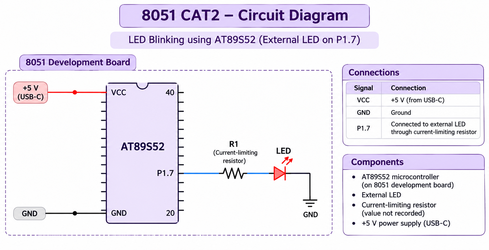

# CAT2 – 8051 Tool Chain Setup and LED Blinking

## EXP
CAT2

## DATE
20/07/2026 (Week 2)

## NAME OF EXP
8051 Tool Chain Setup – Development Board – AT89S52

## HARDWARE SETUP / PLATFORM

- **Development Board:** 8051 Universal Development Board
- **Microcontroller:** AT89S52
- **Development Environment:** Keil µVision
- **Programming Interface:** ISP programming connector
- **Operating Voltage:** +5V
- **External Component:** LED
- **GPIO Port / Pin:** Port 1, pin P1.7
- **Power Source:** USB-C (+5V)

## TASK NO

### Task 1: Hardware Board Bring-Up

- Pinpoint the microcontroller, programmer/debugger, power source, user LED and the GPIO pin it uses.
- Check the board's power rails with a digital multimeter.
- Find the LED's GPIO port and pin using the datasheet and schematic.
- Establish communication between the host PC and the target MCU.

### Task 2: Bare-Metal LED Blink

- Set the LED's GPIO pin as an output through direct register access.
- Build a delay using a plain software loop.
- Blink the LED at roughly 1 Hz.

### Task 3: Custom Delay Library

Write a reusable library function that provides the delay.

## Hardware Bring-Up Sheet

| Parameter | Student Entry |
|---|---|
| MCU | AT89S52 |
| CPU Core | 8051-compatible |
| Operating Voltage | +5V |
| Debug / Programming Interface | ISP |
| LED GPIO Port | Port 1 |
| LED GPIO Pin | P1.7 |
| LED Active State | HIGH (inferred from the code and wiring) |
| LED Frequency (Hz) | Not measured |

*Note: The blink frequency was not verified by measurement; timing comes from a software delay loop.*

## Circuit Diagram

### Hardware Connections

- P1.7 of the AT89S52 drives an external LED through a current-limiting resistor.
- The LED's other terminal goes to GND.
- The board runs from a +5V supply.
- The resistor value was not recorded.

## Core Logic / Pseudocode / Code Base

### 1. Core Logic

This experiment blinks an LED on the AT89S52 using direct register access.

- `reg51.h` exposes the 8051 registers to the program.
- The `sbit` keyword names P1.7 as the LED control pin.
- A custom delay function is built from nested loops.
- The LED is repeatedly turned ON and OFF.
- The delay sets the time between each change of state.

### 2. Pseudocode

1. Start.
2. Declare P1.7 as the LED control pin.
3. Enter an endless loop.
4. Drive the LED pin HIGH.
5. Call the custom delay function.
6. Drive the LED pin LOW.
7. Call the delay function again.
8. Loop forever.

### 3. Source Files

| File | Description |
|---|---|
| `bled.c` | Main program that blinks the LED |
| `delay.c` | Custom software delay routine |
| `delay.h` | Header declaring the delay function |
| `STARTUP.A51` | 8051 startup assembly file |
| `Day1Task1.uvproj` | Keil project configuration |

### 4. Implementation

**bled.c**

The main program pulls in `reg51.h` and `delay.h` and uses `sbit` to name P1.7 as the LED pin.

Inside an infinite loop, it sets the pin HIGH and LOW alternately, calling the delay between transitions.

**delay.c**

Provides a software delay made of two nested loops. The main program calls it to leave a visible gap between LED state changes.

**delay.h**

Declares the delay function so the main program can call it.

### 5. Programming Approach

- Bare-metal embedded C.
- Direct manipulation of GPIO registers.
- Hand-written software delay.
- No Arduino APIs, HAL libraries or RTOS services.

## INFERENCE

The experiment introduces basic microcontroller programming on the AT89S52.

An external LED is driven through P1.7 by writing to the port directly, and a nested-loop delay function spaces out the state changes.

It gives practical experience with GPIO configuration, bare-metal programming, software delay generation and writing reusable C functions and headers.
