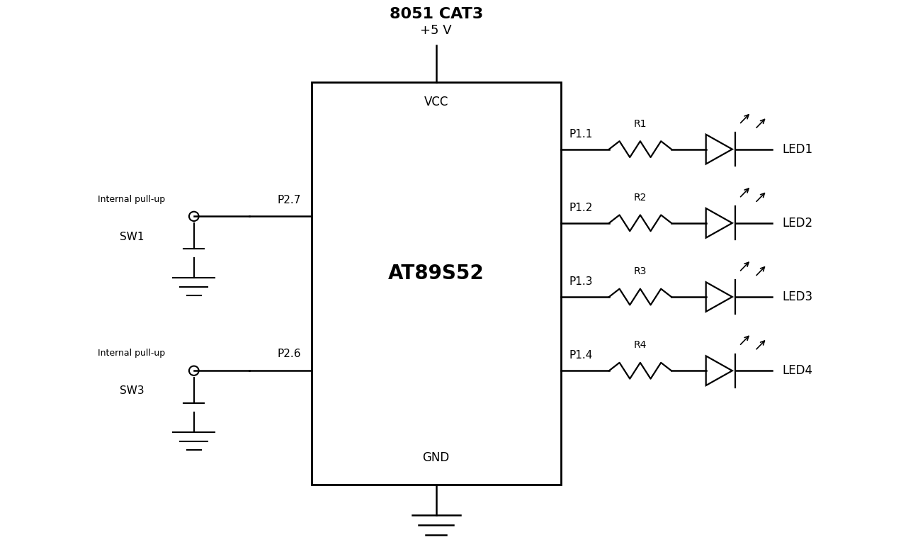

# CAT3 – Timer-Based LED Pattern Generator and Button Interrupt Controller

## EXP
CAT3

## DATE
27/07/2026 (Week 2)

## NAME OF EXP
Timer-Based LED Pattern Generator and Button Interrupt Controller

## HARDWARE SETUP / PLATFORM

- **Development Board:** 8051 Universal Development Board
- **Microcontroller:** AT89S52
- **Development Environment:** Keil µVision
- **Operating Voltage:** +5V
- **Outputs:** Four LEDs on Port 1 (P1.1, P1.2, P1.3 and P1.4)
- **Inputs:** Push-buttons on P2.7 and P2.6

## TASK NO

### Activity: Timer-Based LED Pattern Generator and Button Interrupt Controller

Build a register-level GPIO controller for a microcontroller development board.

Set up four LEDs as digital outputs and the push-buttons as inputs. Using bare-metal Embedded C with direct memory-mapped register access, create a four-state LED control system.

The four required modes are:

1. Running LED pattern.
2. Binary counter.
3. Alternating LED pattern.
4. All LEDs flashing.

Add switch debouncing so that each physical button press causes exactly one state change.

## Circuit Diagram

## Core Logic / Pseudocode / Code Base

### 1. Core Logic

The program produces four LED modes by writing directly to the GPIO ports of the AT89S52.

- The four LEDs are driven from Port 1.
- The push-buttons are read from Port 2.
- A mode variable selects the active LED pattern.
- A software delay sets the time between LED updates.
- Button presses are checked to switch modes.

### 2. Operating Modes

| Mode | Name | Implementation |
|---|---|---|
| Mode 1 | Running LED | LEDs light up one after another. |
| Mode 2 | Binary Counter | A counter steps from 0 to 15. |
| Mode 3 | Alternating Pattern | Toggles between the hex values 0x0A and 0x14. |
| Mode 4 | All LED Flash | Toggles between 0x1E and 0x00. |

### 3. Button Control

The `check_button()` function polls the push-buttons.

- P2.7 moves to the next mode.
- P2.6 moves to the previous mode.
- The program waits for the pressed button to be released.
- The mode value stays within the range 1 to 4.

### 4. Source Files

| File | Description |
|---|---|
| `ledpatterns.c` | Main program with the LED patterns and button handling |
| `Day2Task1.uvproj` | Keil project configuration file |
| `STARTUP.A51` | 8051 startup assembly file |

### 5. Implementation

**ledpatterns.c**

The program includes `reg51.h` for register access.

`sbit` declarations define the push-button inputs on P2.7, P2.1, P2.6 and P2.2.

A global mode variable determines which LED pattern runs.

The `delay()` function relies on nested loops for its software delay.

`check_button()` detects a press, waits until the button is released and then updates the mode.

The main function keeps running whichever pattern is currently selected.

### 6. Programming Approach

- Bare-metal embedded C.
- Direct GPIO register access.
- Port manipulation via the P1 and P2 registers.
- Software-generated delays.
- Polled button reading and mode switching.
- No Arduino APIs, HAL libraries or RTOS services.

## INFERENCE

The experiment shows GPIO programming and simple embedded control on the AT89S52.

Four LED patterns are produced by direct port manipulation. Push-buttons switch between modes, and software delay loops set the pattern timing.

It builds practical understanding of digital I/O configuration, LED pattern generation, button handling and embedded C programming.

## OBSERVATIONS

- Four LED patterns are implemented.
- Push-buttons select the operating mode.
- The mode variable stores the current state.
- Software delay loops set the interval between LED transitions.
