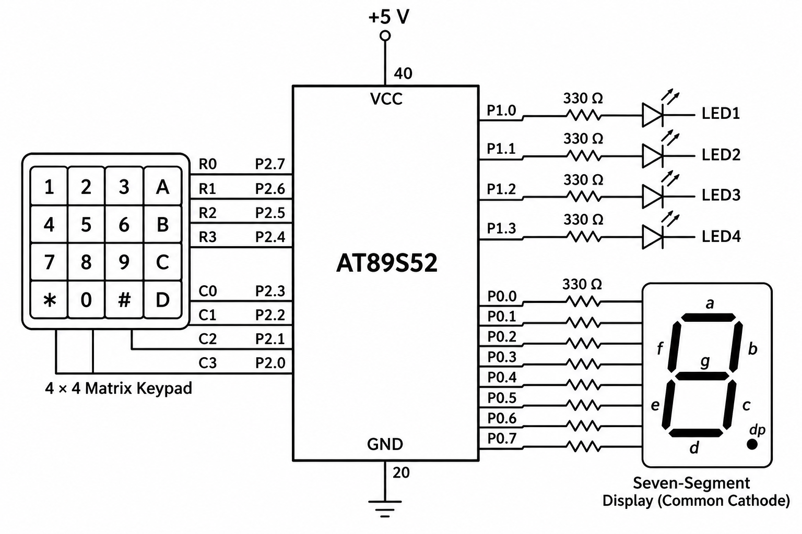

# CAT4 – Human-Machine Interface using Matrix Keypad, LEDs, and Seven-Segment Display

## EXP
CAT4

## DATE
03/08/2026 (Week 3)

## NAME OF EXP
Human-Machine Interface using Matrix Keypad, LEDs, and Seven-Segment Display

## HARDWARE SETUP / PLATFORM

- **Development Board:** 8051 Universal Development Board
- **Microcontroller:** AT89S52
- **Development Environment:** Keil µVision
- **Operating Voltage:** +5V
- **Input Device:** 4×4 matrix keypad
- **Display:** Seven-segment display
- **Output Components:** Four LEDs

### Pin Configuration

| Component | Port / Pins |
|---|---|
| Keypad Rows | P2.7, P2.6, P2.5, P2.4 |
| Keypad Columns | P2.3, P2.2, P2.1, P2.0 |
| Seven-Segment Display | P0.0–P0.7 |
| LED1 | P1.0 |
| LED2 | P1.1 |
| LED3 | P1.2 |
| LED4 | P1.3 |

## TASK NO

### Activity: Human-Machine Interface using Matrix Keypad, LEDs, and Seven-Segment Display

Build a simple embedded user interface where:

- The matrix keypad provides input.
- The seven-segment display gives visual feedback.
- The LEDs show the different operating modes.

Each time a valid key is pressed, the system should:
1. Show the key value on the seven-segment display.
2. Run the LED function assigned to that key.

## Circuit Diagram

## Core Logic / Pseudocode / Code Base

### 1. Core Logic

User input comes from a 4×4 matrix keypad that the AT89S52 scans through its GPIO pins.

The detected key position is used to:
- Show the matching hexadecimal value on the seven-segment display.
- Run the LED operation linked to that key.

Port 0 drives the seven-segment display and Port 1 drives the four LEDs.

### 2. Keypad Scanning

`keypad_scan()` carries out row-by-row scanning.

- The four rows connect to P2.7–P2.4.
- The four columns connect to P2.3–P2.0.
- Only one row is activated at a time.
- The column inputs are read to find which key is pressed.
- The function returns a value from 0 to 15 for the detected key position.

### 3. Seven-Segment Display

`display_digit()` uses a switch-case to choose the segment pattern for each value.

The pattern is written straight to Port 0.

The lookup covers values 0 to 15, including the hexadecimal characters A–F.

### 4. LED Control Modes

`led_control()` picks the LED operation based on the keypad index.

| Keypad Index | LED Operation |
|---|---|
| 0 | LED1 ON |
| 1 | LED2 ON |
| 2 | LED3 ON |
| 3 | LED4 ON |
| 4 | Running LED pattern |
| 5 | Alternating LED pattern |
| 6 | Binary counter |
| 7 | All LEDs blink |
| 8 | All LEDs OFF |
| Any other value | All LEDs OFF |

### 5. LED Pattern Functions

`patterns.c` defines the following functions:

**runningPattern()**

Lights the LEDs one after another through Port 1.

**alternatingPattern()**

Switches back and forth between the patterns `1010` and `0101`.

**binaryCounter()**

Shows a four-bit binary count from 0 to 15 on the four LEDs.

**flash()**

Switches between all LEDs ON (`1111`) and all LEDs OFF (`0000`).

### 6. Delay Implementation

`delay()` is built from nested software loops.

It supplies the timing needed by the LED patterns.

### 7. Source Files

| File | Description |
|---|---|
| `mini.c` | Main program: keypad scanning, seven-segment display and LED control |
| `patterns.c` | LED pattern functions |
| `patterns.h` | Declarations for the pattern functions |
| `delay.c` | Software delay routine |
| `delay.h` | Declaration of the delay function |
| `Day3Task1.uvproj` | Keil project configuration |

## Implementation Notes

- The keypad scan returns row/column position indices from 0 to 15.
- The seven-segment display shows the returned index via a lookup table.
- `led_control()` handles indices 0–8.
- The current code relies on software polling and delay loops.
- The evaluation sheet's physical-key-to-operation mapping and reset behaviour are not fully covered by the current source.
- No Arduino APIs, HAL libraries or RTOS services are used.

## INFERENCE

The experiment implements a basic human-machine interface on the AT89S52.

A 4×4 matrix keypad takes the user's input, a seven-segment display provides feedback, and four GPIO-driven LEDs show different output patterns.

It gives practical experience with matrix keypad scanning, GPIO configuration, seven-segment interfacing, LED pattern generation and embedded C programming.
