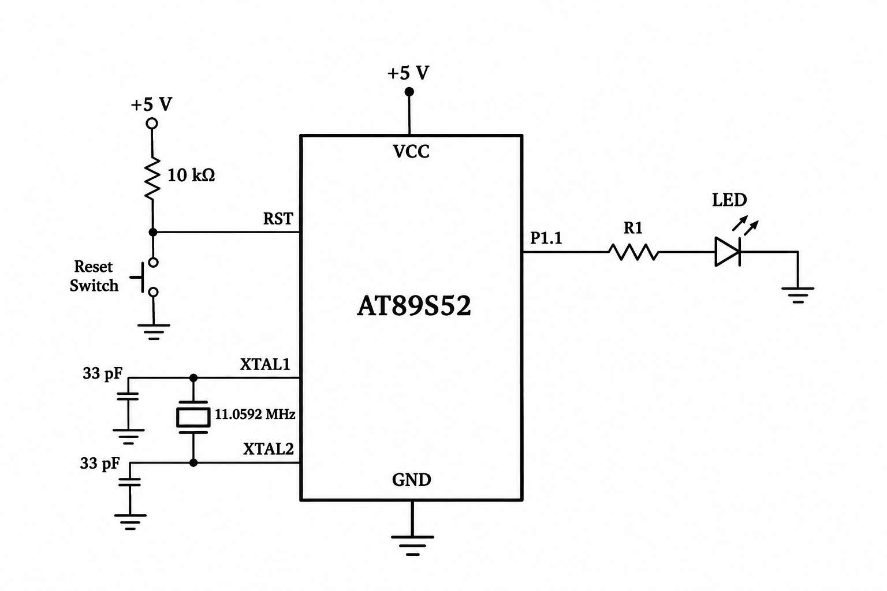

# CAT5 – Timer-Based LED Toggle Using Timer 0

## EXP
CAT5 – Task 1

## DATE
10/08/2026 (Week 4)

## NAME OF EXP
Hardware Timer and Interrupt-Based Timing for LED Fading, Pulse Generation, and Stepper Motor Control

## HARDWARE SETUP / PLATFORM

- **Development Board:** 8051 Universal Development Board
- **Microcontroller:** AT89S52
- **Development Environment:** Keil µVision
- **Crystal Frequency:** 11.0592 MHz
- **Operating Voltage:** +5V
- **Output Component:** External LED on P1.1
- **Timer:** Timer 0, Mode 1 (16-bit)

## TASK NO

### Task 1: LED Toggle Using Hardware Timer

Set up Timer 0 to produce an accurate periodic timing event, use it as a software time base, and toggle an LED every second. Confirm the resulting timing with an oscilloscope.

The hardware timer serves as the time reference for controlling the LED.

## Circuit Diagram

## Core Logic / Pseudocode / Code Base

### 1. Core Logic

The program uses Timer 0 of the AT89S52 to generate periodic timing events.

- Timer 0 runs in Mode 1 (16-bit mode).
- TH0 and TL0 are preloaded with starting values.
- The TR0 control bit starts the timer.
- The program keeps polling the TF0 overflow flag.
- On each overflow, the flag is cleared and the timer is reloaded.
- A software counter records how many overflows have occurred.
- When the counter hits 86, the LED on P1.1 is toggled.

### 2. Pseudocode

1. Start.
2. Configure Timer 0 for Mode 1.
3. Load TH0 with 0xE6.
4. Load TL0 with 0xCD.
5. Start Timer 0.
6. Keep checking the TF0 overflow flag.
7. If an overflow has occurred:
   - Clear TF0.
   - Reload TH0 and TL0.
   - Increment the software counter.
8. If the counter equals 86:
   - Reset the counter.
   - Toggle the LED on P1.1.
9. Repeat.

### 3. Source Files

| File | Description |
|---|---|
| `timer_led.c` | Main program: Timer 0 setup and LED toggling |
| `Day4Task1.uvproj` | Keil µVision project configuration |
| `STARTUP.A51` | 8051 startup assembly file |

### 4. Implementation

**timer_led.c**

The program includes `reg51.h` for access to the 8051 hardware registers.

The LED sits on P1.1 and is declared with `sbit`.

Timer 0 is set up as follows:

- `TMOD = 0x01` selects Mode 1.
- `TH0 = 0xE6` loads the high byte of the timer.
- `TL0 = 0xCD` loads the low byte of the timer.
- `TR0 = 1` starts the timer.

`timer0_check()` polls the TF0 overflow flag.

Each overflow reloads the timer and increments the software counter. After 86 overflows, the LED changes state.

### 5. Programming Approach

- Bare-metal embedded C.
- Direct access to the 8051 timer registers.
- Timer 0 in 16-bit Mode 1.
- Polling of the timer overflow flag.
- Software counter to tally overflows.
- GPIO output control on P1.1.
- No Arduino APIs, HAL libraries or RTOS services.

## INFERENCE

The experiment covers hardware timer setup and GPIO control on the AT89S52.

Timer 0 in 16-bit Mode 1 produces periodic overflow events. The overflow flag is polled, and a software counter decides when the LED should change state.

It gives practical experience with timer configuration, overflow monitoring, register-level programming and timer-driven LED control.

## IMPLEMENTATION NOTE

The evaluation sheet calls for interrupt-driven timing with the LED toggling at 1-second intervals. The submitted code polls the Timer 0 overflow flag instead of using a timer interrupt service routine.

The timer reload value is 0xE6CD and the LED toggles after 86 overflows. The actual output period has not been checked with an oscilloscope.
