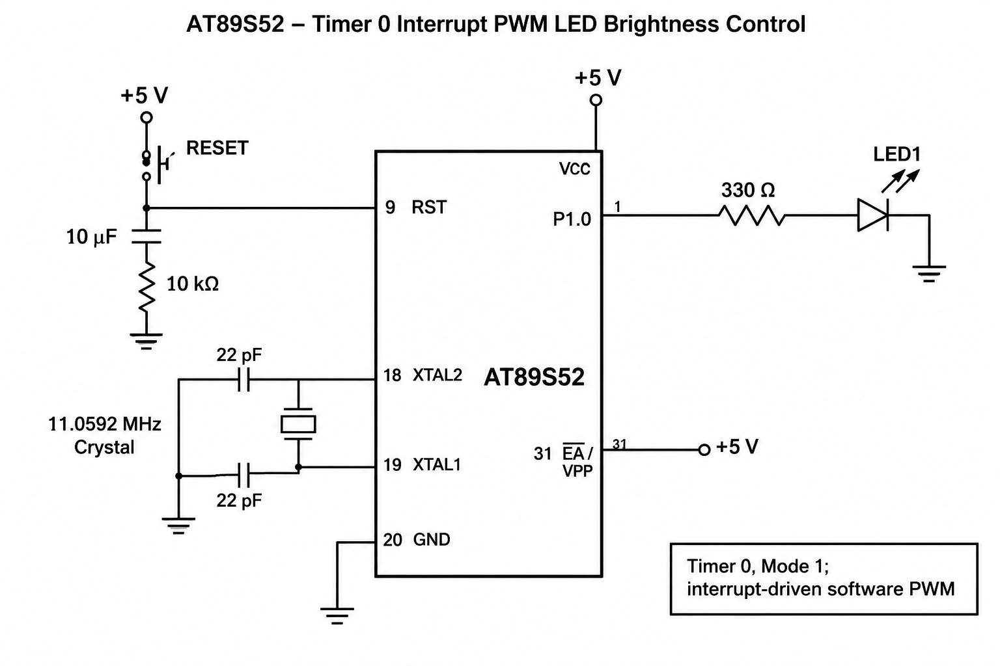

# CAT5 – Timer Interrupt-Based LED Fading Using Software PWM

## EXP
CAT5

## DATE
10/08/2026 (Week 4)

## NAME OF EXP
Hardware Timer and Interrupt-Based Timing for LED Fading

## HARDWARE SETUP / PLATFORM

- **Development Board:** 8051 Universal Development Board
- **Microcontroller:** AT89S52
- **Development Environment:** Keil µVision
- **Operating Voltage:** +5V
- **Clock Frequency:** 11.0592 MHz (assumed)
- **Output Component:** LED on P1.0 (Port 1)
- **Timer:** Timer 0, Mode 1 (16-bit)
- **Interrupt:** Timer 0 overflow interrupt

## TASK NO

### Task 2: LED Fading Using Software PWM

Building on the timer interrupt from Task 1, produce a software PWM signal and sweep the duty cycle from 0% to 100% and back to 0%, giving a visible fade on the LED.

A hardware timer interrupt acts as the timing reference, while software logic sets the LED brightness.

## Circuit Diagram

## Core Logic / Pseudocode / Code Base

### 1. Core Logic

The program controls LED brightness with software Pulse Width Modulation (PWM) on the AT89S52.

- Timer 0 runs in Mode 1 (16-bit mode).
- Timer 0 raises periodic interrupts.
- The timer is reloaded inside the interrupt service routine.
- A counter variable tracks the PWM period.
- A duty-cycle variable sets how long the LED stays ON.
- The duty cycle steps down from 100% to 0%, then back up to 100%.
- The LED is switched ON or OFF by comparing the counter with the duty cycle.

### 2. PWM Operation

PWM sets LED brightness by changing the share of each PWM period during which the LED is ON.

| Duty Cycle | LED Brightness |
|---|---|
| 0% | OFF |
| 25% | Dim |
| 50% | Medium |
| 75% | Bright |
| 100% | Fully ON |

The program keeps adjusting the duty cycle to create the fading effect.

### 3. Timer Configuration

Timer 0 is set up through the TMOD register.

- `TMOD = 0x01` puts Timer 0 in Mode 1.
- `TH0 = 0xFC` and `TL0 = 0x66` give the initial timer count.
- This reload value yields roughly a 1 ms interval, assuming an 11.0592 MHz crystal and a classic 12-clock 8051.
- `IE = 0x82` turns on the global interrupt enable and the Timer 0 interrupt.
- `TR0 = 1` starts Timer 0.

### 4. PWM Generation

The interrupt service routine does the following:

1. Reloads Timer 0.
2. Increments the counter variable.
3. Resets the counter once it reaches 100.
4. Adjusts the duty cycle according to the direction flag.
5. Reverses direction when the duty cycle reaches 0% or 100%.
6. Compares the counter against the duty cycle to drive the LED.

### 5. Source Files

| File | Description |
|---|---|
| `ledfading.c` | Main program: Timer 0 interrupt and software PWM |
| `CAT5Task2.uvproj` | Keil project configuration file |
| `STARTUP.A51` | 8051 startup assembly file |
| `CAT5Task2.hex` | Generated HEX file for programming the microcontroller |
| `circuit.png` | Circuit diagram showing the AT89S52 and LED wiring |

### 6. Implementation

**ledfading.c**

The program includes `reg51.h` for register access.

`sbit` defines the LED output on P1.0.

Three global variables are used:

- `count` – the PWM counter.
- `duty` – the present duty cycle.
- `increasing` – tells whether the duty cycle is rising or falling.

Timer 0 is placed in 16-bit Mode 1 through TMOD.

The Timer 0 interrupt service routine, declared with `interrupt 1`, reloads the timer, updates the PWM counter and adjusts the duty cycle.

The LED is driven by comparing the counter with the duty cycle.

The main function initialises the timer and enables interrupts. Its infinite loop is empty because all LED control happens within the interrupt service routine.

### 7. Programming Approach

- Bare-metal embedded C.
- Direct register-level programming.
- Timer 0 configured via TMOD.
- 16-bit timer operation.
- Interrupt-driven timing.
- Software Pulse Width Modulation (PWM).
- Duty-cycle variation to control brightness.
- No Arduino APIs, HAL libraries or RTOS services.

## INFERENCE

The experiment demonstrates hardware timer setup and interrupt-driven LED brightness control on the AT89S52.

Software PWM works by repeatedly comparing a counter with the duty cycle. Raising and lowering the duty cycle gradually makes the LED brightness change smoothly, producing a fade.

It gives practical experience with timer operation, interrupt handling, PWM generation, duty-cycle control and embedded C programming.

## OBSERVATIONS

- Timer 0 runs in 16-bit Mode 1.
- Periodic timer interrupts provide the software timing reference.
- The LED brightness gradually falls and rises.
- The duty cycle sweeps between 0% and 100%.
- A direction flag decides whether the duty cycle goes up or down.
- The LED is driven from P1.0.
- The main function uses no software delay loops for timing.
