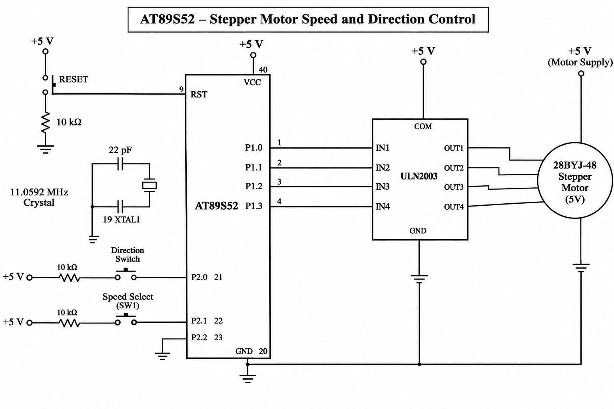

# CAT5 – Stepper Motor Speed and Direction Control

## EXP
CAT5

## DATE
10/08/2026 (Week 4)

## NAME OF EXP
Hardware Timer and Interrupt-Based Stepper Motor Control

## HARDWARE SETUP / PLATFORM

- **Development Board:** 8051 Universal Development Board
- **Microcontroller:** AT89S52
- **Development Environment:** Keil µVision
- **Operating Voltage:** +5V
- **Clock Frequency:** 11.0592 MHz
- **Output Component:** 5V stepper motor (28BYJ-48)
- **Motor Driver:** ULN2003
- **Motor Control Pins:** P1.0, P1.1, P1.2 and P1.3 (Port 1)
- **Inputs:** Push-buttons
  - Direction: P2.0
  - Speed selection: P2.1 and P2.2
- **Timer:** Timer 0, Mode 1 (16-bit)

## TASK NO

### Task 3: Stepper Motor Speed and Direction Control

Design and build a timer-driven stepper motor controller around the AT89S52.

A hardware timer generates periodic interrupts that set the stepping pace.

The motor turns using a four-step excitation sequence. Its speed depends on the interval between steps, and its direction is chosen with a digital input.

## Circuit Diagram

## Core Logic / Pseudocode / Code Base

### 1. Core Logic

The program drives a stepper motor using Timer 0 interrupts and digital outputs.

- Four Port 1 output pins connect to a ULN2003 motor driver.
- The ULN2003 interfaces the AT89S52 to the stepper motor.
- Timer 0 raises an interrupt every 1 ms.
- A software counter measures elapsed time.
- When the selected interval has passed, the next motor step is issued.
- Push-button inputs choose the direction and speed.

### 2. Stepper Motor Sequence

The motor is driven with a four-step excitation sequence.

| Step | Output Pattern |
|---|---|
| Step 1 | 1000 |
| Step 2 | 0100 |
| Step 3 | 0010 |
| Step 4 | 0001 |

Repeating the sequence keeps the motor turning, and running it in reverse order reverses the rotation.

### 3. Speed Control

The step interval sets the motor speed.

| Speed | Time Interval |
|---|---|
| Slow | 100 ms/step |
| Medium | 50 ms/step |
| Fast | 10 ms/step |

Shorter intervals make the motor turn faster; longer intervals make it turn slower.

### 4. Direction Control

Rotation direction is set by the P2.0 input.

- With the direction switch released, the motor follows the forward sequence.
- With the direction switch pressed, the motor follows the reverse sequence.

### 5. Timer Configuration

Timer 0 operates in Mode 1 (16-bit timer mode).

- `TMOD` configures Timer 0.
- `TH0 = 0xFC` and `TL0 = 0x66` give an interval of about 1 ms.
- `ET0 = 1` enables the Timer 0 interrupt.
- `EA = 1` enables interrupts globally.
- `TR0 = 1` starts Timer 0.

The interrupt service routine updates the timing counter and tells the main program when the next step is due.

### 6. Source Files

| File | Description |
|---|---|
| `stepper.c` | Main program for stepper motor control |
| `CAT5Task3.uvproj` | Keil project configuration file |
| `STARTUP.A51` | 8051 startup assembly file |
| `CAT5Task3.hex` | Generated HEX file |
| `circuit.png` | Stepper motor interface circuit diagram |

### 7. Programming Approach

- Bare-metal embedded C.
- Direct register-level programming.
- Timer 0 configured via TMOD.
- 16-bit timer operation.
- Interrupt-driven timing.
- Four-step motor excitation sequence.
- Speed selection in software.
- Direction chosen by a digital input.
- No Arduino APIs, HAL libraries or RTOS services.

## INFERENCE

The experiment shows timer-based stepper motor control on the AT89S52.

Timer 0 interrupts supply the timing reference for motor operation. Varying the interval between steps produces different motor speeds.

Direction is changed by reversing the excitation sequence. The experiment gives practical experience with hardware timers, interrupts, digital outputs, motor interfacing and embedded C programming.

## OBSERVATIONS

- The stepper motor turns using a four-step excitation sequence.
- A ULN2003 driver connects the motor to the microcontroller.
- Timer 0 interrupts provide the timing reference.
- Motor speed follows the selected step interval.
- The direction input switches between forward and reverse rotation.
- Timing comes from the timer rather than software delay loops.
