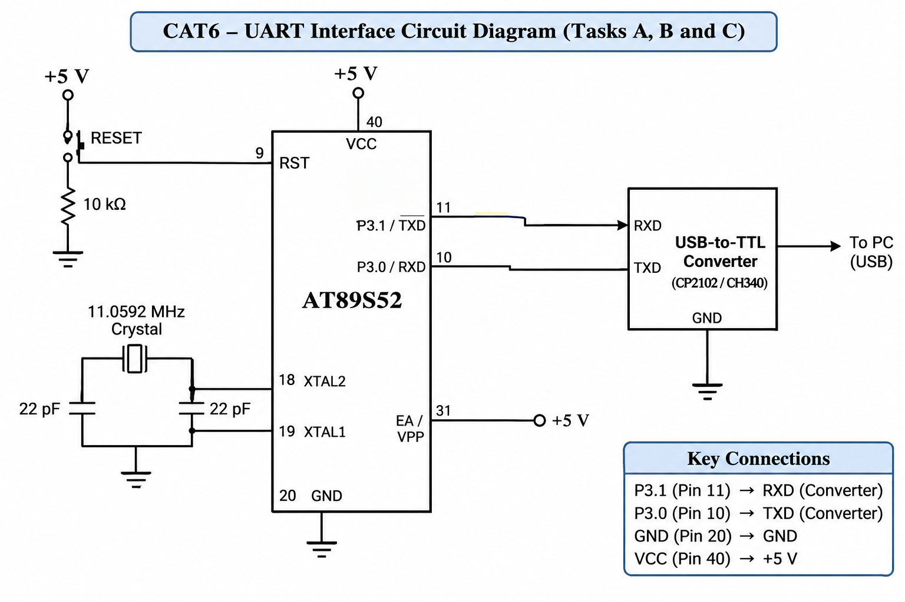

# CAT6 – Task A: UART Initialization and Character Transmission

## EXP
CAT6

## NAME OF EXP
UART Initialization and Character Transmission

## HARDWARE SETUP / PLATFORM

- **Microcontroller:** AT89S52
- **Development Board:** 8051 Universal Development Board
- **Development Environment:** Keil µVision
- **Operating Voltage:** +5V
- **Crystal Frequency:** 11.0592 MHz
- **Communication Interface:** UART on P3.0 (RXD) and P3.1 (TXD)
- **Serial Converter:** USB-to-TTL
- **PC Terminal:** PuTTY
- **Baud Rate:** 9600

## TASK DESCRIPTION

Set up the AT89S52 UART for serial communication with a PC. Initialise it using Timer 1 in Mode 2 and send the message "Hello from 8051" repeatedly to the PC terminal.

## CIRCUIT DIAGRAM

## CORE LOGIC

1. Put Timer 1 in Mode 2.
2. Load TH1 with 0xFD to get 9600 baud.
3. Set SCON for UART Mode 1.
4. Start Timer 1.
5. Write each character into SBUF.
6. Wait for TI to become 1.
7. Clear TI and move on to the next character.
8. Keep sending the message to PuTTY.

## SOURCE FILES

| File | Description |
|---|---|
| `lab6part1.c` | UART initialisation and transmit program |
| `STARTUP.A51` | 8051 startup assembly file |
| `CAT6_TaskA.uvproj` | Keil project file |
| `CAT6_TaskA.hex` | Generated HEX file |
| `circuit.png` | UART interface circuit diagram |

## PROGRAMMING APPROACH

- Bare-metal embedded C.
- Direct register-level programming.
- UART set up through SCON and SBUF.
- Timer 1 in Mode 2 as the baud-rate generator.
- Polled transmission using the TI flag.
- Serial debugging with PuTTY.

## INFERENCE

The experiment demonstrates UART initialisation and character transmission on the AT89S52. Timer 1 produces the baud rate, and the SBUF register carries the characters to the PC. Seeing the message appear in PuTTY confirms that serial communication works.

## OBSERVATIONS

- UART communication runs at 9600 baud.
- Timer 1 operates in Mode 2.
- The message appears repeatedly in PuTTY.
- The TI flag marks the end of each character transmission.
