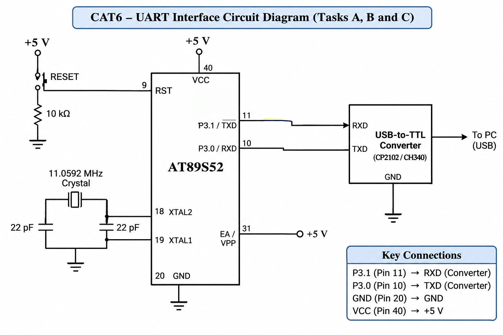

# CAT6 – Task B: UART Character Reception and Echo

## EXP
CAT6

## NAME OF EXP
UART Character Reception and Echo

## HARDWARE SETUP / PLATFORM

- **Microcontroller:** AT89S52
- **Development Board:** 8051 Universal Development Board
- **Development Environment:** Keil µVision
- **Operating Voltage:** +5V
- **Crystal Frequency:** 11.0592 MHz
- **Communication Interface:** UART on P3.0 (RXD) and P3.1 (TXD)
- **Serial Converter:** USB-to-TTL
- **PC Terminal:** PuTTY
- **Baud Rate:** 9600

## TASK DESCRIPTION

Extend the UART transmit program so it receives characters from the PC terminal and sends the same characters back. The result is a simple polled UART echo.

## CIRCUIT DIAGRAM

## CORE LOGIC

1. Initialise the UART with Timer 1 in Mode 2.
2. Configure serial communication for 9600 baud.
3. Wait for the RI flag to become 1.
4. Read the received character from SBUF.
5. Clear the RI flag.
6. Write the received character back into SBUF to send it.
7. Wait for TI to become 1.
8. Clear TI and repeat.

## SOURCE FILES

| File | Description |
|---|---|
| `lab6part2.c` | UART receive and echo program |
| `STARTUP.A51` | 8051 startup assembly file |
| `CAT6_TaskB.uvproj` | Keil project file |
| `CAT6_TaskB.hex` | Generated HEX file |
| `circuit.png` | UART interface circuit diagram |

## PROGRAMMING APPROACH

- Bare-metal embedded C.
- Direct register-level programming.
- UART set up through SCON and SBUF.
- Timer 1 in Mode 2 as the baud-rate generator.
- Polled reception using RI.
- Polled transmission using TI.
- Serial debugging with PuTTY.

## INFERENCE

The experiment demonstrates two-way serial communication between the AT89S52 and a PC. Characters typed in PuTTY are received by the microcontroller and returned over UART. It builds understanding of UART reception, the transmit/receive flags and serial communication.

## OBSERVATIONS

- Characters typed in PuTTY are received correctly.
- The received characters are sent back to the PC.
- The RI flag signals that a character has arrived.
- The TI flag signals that transmission has finished.
- UART communication runs at 9600 baud.
