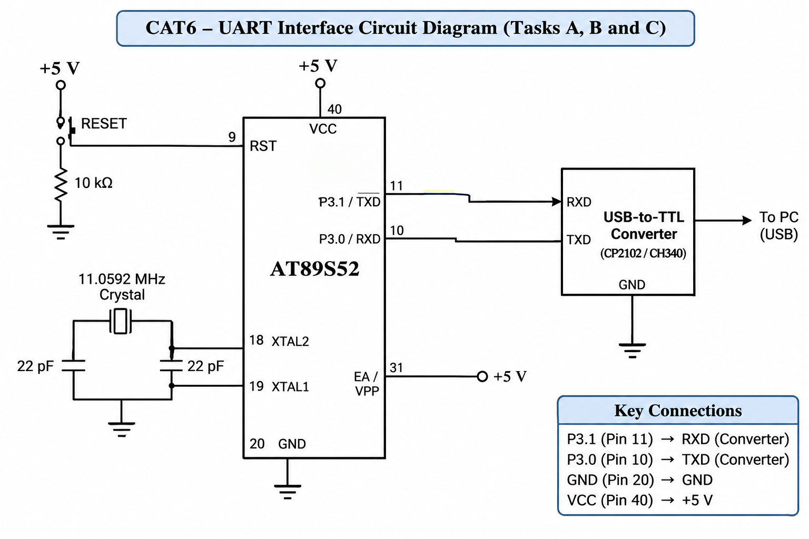

# CAT6 – Task C: Interrupt-Driven UART Reception Using Ring Buffer

## EXP
CAT6

## NAME OF EXP
Interrupt-Driven UART Reception and Circular Buffer Implementation

## HARDWARE SETUP / PLATFORM

- **Microcontroller:** AT89S52
- **Development Board:** 8051 Universal Development Board
- **Development Environment:** Keil µVision
- **Operating Voltage:** +5V
- **Crystal Frequency:** 11.0592 MHz
- **Communication Interface:** UART on P3.0 (RXD) and P3.1 (TXD)
- **Serial Converter:** USB-to-TTL
- **PC Terminal:** PuTTY
- **Baud Rate:** 9600
- **Buffer Size:** 16 bytes

## TASK DESCRIPTION

Receive UART data using the AT89S52 serial interrupt. Incoming characters are placed in a circular buffer, then picked up by the main program and sent back to the PC terminal.

## CIRCUIT DIAGRAM

## CORE LOGIC

1. Initialise the UART with Timer 1 in Mode 2.
2. Enable the serial and global interrupts.
3. Wait for incoming serial data.
4. A received character triggers the serial interrupt.
5. Read the character from SBUF.
6. Store it in the circular buffer.
7. Advance the head pointer.
8. The main program checks whether the buffer holds any data.
9. It reads a character using the tail pointer.
10. It sends that character back to the PC.

## RING BUFFER IMPLEMENTATION

The circular buffer is managed with two index variables.

- **Head:** the next free slot for incoming data.
- **Tail:** the next slot to read from.
- **Buffer Size:** 16 bytes.
- **Usable Capacity:** 15 bytes, since one slot is kept empty to tell a full buffer from an empty one.

If the buffer is full, any further incoming characters are dropped.

## SOURCE FILES

| File | Description |
|---|---|
| `lab6part3.c` | Interrupt-driven UART receive and ring buffer program |
| `STARTUP.A51` | 8051 startup assembly file |
| `CAT6_TaskC.uvproj` | Keil project file |
| `CAT6_TaskC.hex` | Generated HEX file |
| `circuit.png` | UART interface circuit diagram |

## PROGRAMMING APPROACH

- Bare-metal embedded C.
- Direct register-level programming.
- UART set up through SCON and SBUF.
- Timer 1 in Mode 2 as the baud-rate generator.
- Serial interrupt handling via interrupt 4.
- Circular buffer implementation.
- Head and tail pointer management.
- Interrupt-driven reception.
- Serial debugging with PuTTY.

## INFERENCE

The experiment demonstrates interrupt-driven UART communication and circular buffer handling on the AT89S52. The serial interrupt lets incoming characters be handled without constantly polling the receive flag, while the ring buffer holds them until the main program is ready.

It gives practical experience with serial interrupts, asynchronous communication, circular buffers and efficient data handling in embedded systems.

## OBSERVATIONS

- The serial interrupt fires whenever a character is received.
- Incoming characters are stored in the circular buffer.
- The head and tail variables track buffer positions.
- The main program fetches buffered characters and echoes them.
- On overflow, new characters are discarded.
- UART communication runs at 9600 baud.
