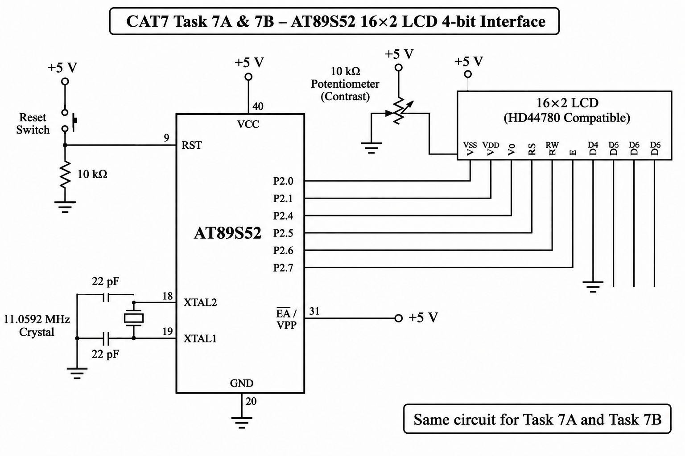

# CAT7 – Task 7A: LCD Initialization and Character/String Display

## EXP
CAT7

## DATE
24/08/2026 (Week 6)

## NAME OF EXP
LCD Initialization and Character/String Display

## HARDWARE SETUP / PLATFORM

- **Development Board:** 8051 Universal Development Board
- **Microcontroller:** AT89S52
- **Development Environment:** Keil µVision
- **Operating Voltage:** +5V
- **Display:** 16×2 character LCD
- **LCD Controller:** HD44780-compatible
- **LCD Interface:** 4-bit GPIO mode
- **LCD Data Pins:** D4, D5, D6 and D7
- **LCD Control Pins:** RS and E
- **Language:** Embedded C

## TASK NO

### Task 7A – LCD Initialization and Character/String Display

Write a 4-bit GPIO-driven LCD driver for the AT89S52, working out the needed command sequence from the HD44780-compatible LCD datasheet.

The goal is to initialise a 16×2 LCD, set its operating mode, and show single characters and strings on both rows.

## CIRCUIT DIAGRAM

### LCD Pin Connections

| LCD Pin | AT89S52 Connection |
|---|---|
| RS | P2.0 |
| RW | GND |
| E | P2.1 |
| D4 | P2.4 |
| D5 | P2.5 |
| D6 | P2.6 |
| D7 | P2.7 |
| VSS | GND |
| VDD | +5V |
| V0 | Contrast potentiometer |

## CORE LOGIC / PSEUDOCODE / CODE BASE

### 1. Core Logic

The program is a low-level LCD driver built on direct GPIO register access.

- The LCD works in 4-bit mode.
- It is set up for two-line operation.
- Commands are issued using the RS and E control pins.
- Character data travels over D4–D7.
- Single characters and strings are shown on the LCD.

### 2. LCD Initialization

`lcd_init()` sets the LCD up for 4-bit, 2-line operation.

The initialisation sequence consists of:

- Switching the interface to 4-bit mode.
- Choosing two-line display operation.
- Setting the display and cursor options.
- Turning the display on.
- Clearing the display.
- Setting the entry mode.

### 3. LCD Driver Functions

| Function | Description |
|---|---|
| `lcd_init()` | Initialises the LCD |
| `lcd_cmd()` | Sends commands to the LCD |
| `lcd_data()` | Sends character data to the LCD |

`lcd_cmd()` delivers control instructions, while `lcd_data()` passes characters to be displayed.

### 4. Display Operation

The program carries out these steps:

1. Initialise the LCD.
2. Move to the first position of the first row.
3. Send the character `A` using `lcd_data()`.
4. Show further individual characters.
5. Show strings by sending their characters one at a time.
6. Display text on both LCD rows.

### 5. Source Files

| File | Description |
|---|---|
| `task7A.c` | LCD initialisation and character/string display program |
| `STARTUP.A51` | 8051 startup assembly file |
| `CAT7_TaskA.uvproj` | Keil project configuration file |
| `CAT7_TaskA.hex` | Generated HEX file |
| `circuit.png` | Shared LCD and keypad circuit diagram |

## PROGRAMMING APPROACH

- Bare-metal embedded C.
- Direct GPIO register-level programming.
- 4-bit LCD interfacing.
- HD44780-compatible command sequence.
- LCD initialisation and configuration.
- Character and string output.
- No Arduino APIs, HAL libraries or RTOS services.

## INFERENCE

The experiment demonstrates low-level interfacing of a 16×2 LCD to the AT89S52 over a 4-bit GPIO connection.

The LCD is initialised by sending a series of commands that set its operating mode, and routines for character and string display pass data to it.

It gives practical experience with reading peripheral datasheets, LCD command sequences, GPIO control and embedded C driver development.

## OBSERVATIONS

- The LCD is initialised in 4-bit mode.
- The display works in two-line mode.
- Individual characters are shown successfully.
- Strings are shown on both LCD rows.
- Commands and character data are sent through separate functions.
