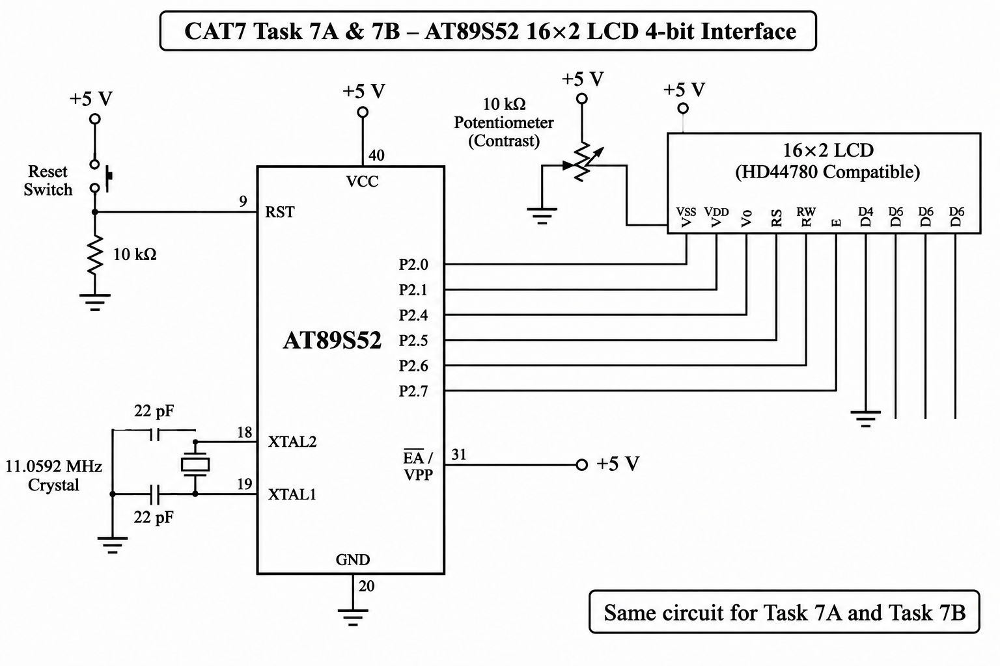

# CAT7 – Task 7B: Cursor Positioning and Dynamic Value Update

## EXP
CAT7

## DATE
24/08/2026 (Week 6)

## NAME OF EXP
LCD Cursor Positioning and Dynamic Value Update

## HARDWARE SETUP / PLATFORM

- **Development Board:** 8051 Universal Development Board
- **Microcontroller:** AT89S52
- **Development Environment:** Keil µVision
- **Operating Voltage:** +5V
- **Display:** 16×2 character LCD
- **LCD Controller:** HD44780-compatible
- **LCD Interface:** 4-bit GPIO mode
- **LCD Data Pins:** D4, D5, D6 and D7
- **LCD Control Pins:** RS and E
- **Language:** Embedded C

## TASK NO

### Task 7B – Cursor Positioning and Dynamic Value Update

Write LCD functions for cursor positioning and data updates on the AT89S52.

The aim is to place the cursor at chosen row and column positions, display strings, print numeric values and refresh the displayed information on the fly.

## CIRCUIT DIAGRAM

### LCD Pin Connections

| LCD Pin | AT89S52 Connection |
|---|---|
| RS | P2.0 |
| RW | GND |
| E | P2.1 |
| D4 | P2.4 |
| D5 | P2.5 |
| D6 | P2.6 |
| D7 | P2.7 |
| VSS | GND |
| VDD | +5V |
| V0 | Contrast potentiometer |

## CORE LOGIC / PSEUDOCODE / CODE BASE

### 1. Core Logic

The program builds on the Task 7A LCD driver by adding functions for cursor positioning and dynamic data display.

- Initialise the LCD in 4-bit mode.
- Place the cursor at a given row and column.
- Show strings at chosen positions.
- Convert numeric values into printable characters.
- Update values at specific LCD locations.

### 2. LCD Cursor Positioning

`lcd_goto(row, column)` moves the cursor to the requested LCD position.

- The LCD has two rows.
- Each row holds 16 character positions.
- The position is selected by sending the matching DDRAM address command.

### 3. LCD Display Functions

The following functions are implemented:

| Function | Description |
|---|---|
| `lcd_init()` | Initialises the LCD |
| `lcd_cmd()` | Sends LCD commands |
| `lcd_data()` | Sends character data |
| `lcd_goto(row, column)` | Positions the cursor |
| `lcd_puts(string)` | Displays a string |
| `lcd_print_number(value)` | Displays a numeric value |

### 4. Dynamic Value Update

The program uses cursor positioning to refresh information at specific places on the LCD.

The steps are:

1. Initialise the LCD.
2. Position the cursor with `lcd_goto()`.
3. Show text with `lcd_puts()`.
4. Move the cursor to where the number should appear.
5. Show the number with `lcd_print_number()`.
6. Update the displayed value when needed.
7. Clear or overwrite old characters so no stray digits remain.

### 5. Source Files

| File | Description |
|---|---|
| `task7B.c` | LCD cursor positioning and dynamic value update program |
| `STARTUP.A51` | 8051 startup assembly file |
| `CAT7_TaskB.uvproj` | Keil project configuration file |
| `CAT7_TaskB.hex` | Generated HEX file |
| `circuit.png` | Shared LCD and keypad circuit diagram |

## PROGRAMMING APPROACH

- Bare-metal embedded C.
- Direct GPIO register-level programming.
- 4-bit LCD interfacing.
- LCD command and data transfer.
- Cursor positioning with DDRAM addresses.
- String display.
- Numeric conversion and display.
- Dynamic LCD updates.
- No Arduino APIs, HAL libraries or RTOS services.

## INFERENCE

The experiment demonstrates cursor positioning and dynamic display control on a 16×2 LCD connected to the AT89S52.

`lcd_goto()` lets information appear at specific row and column positions. Extra functions handle strings and numbers, so the LCD can refresh its contents without being re-initialised each time.

It gives practical experience with LCD addressing, cursor control, numeric display and embedded C driver development.

## OBSERVATIONS

- The cursor is placed at the required row and column.
- Strings appear at the selected positions.
- Numeric values are shown through a dedicated function.
- Displayed values can be updated dynamically.
- The driver handles both character and numeric output.
