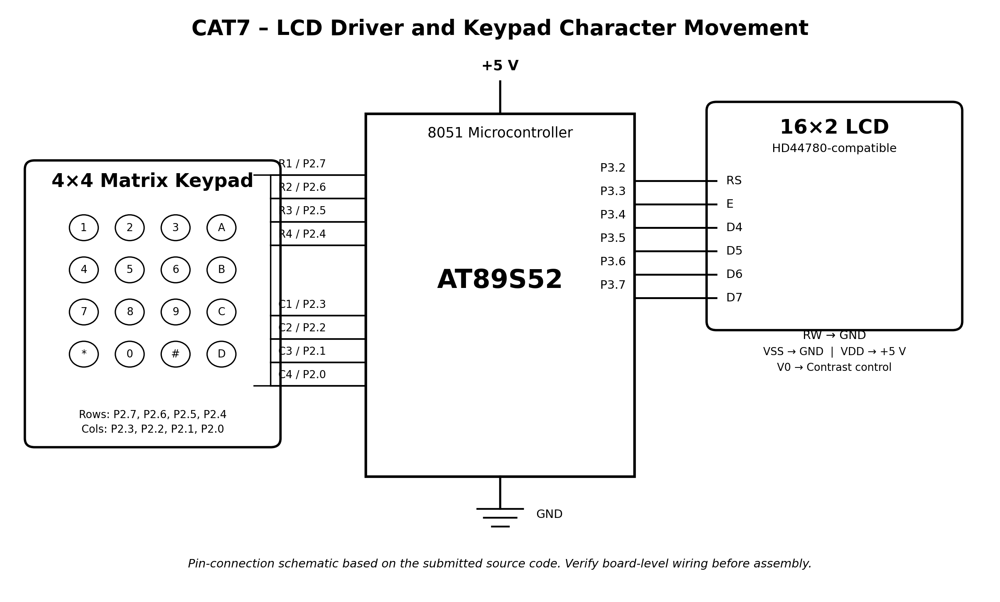

# CAT7 – 16×2 LCD Driver Development and Dynamic Display Control

## EXP
CAT7

## DATE
24/08/2026 (Week 6)

## NAME OF EXP
16×2 LCD Driver Development and Dynamic Display Control

## HARDWARE SETUP / PLATFORM

- **Development Board:** 8051 Development Board
- **Microcontroller:** AT89S52
- **LCD:** 16×2 HD44780-compatible character LCD
- **Input Device:** 4×4 matrix keypad
- **Language:** Embedded C
- **IDE / Toolchain:** Keil µVision

### Pin Configuration

| Peripheral | Signal | AT89S52 pin |
|---|---|---|
| LCD | RS | P3.2 |
| LCD | E | P3.3 |
| LCD | D4 | P3.4 |
| LCD | D5 | P3.5 |
| LCD | D6 | P3.6 |
| LCD | D7 | P3.7 |
| Keypad | Row 1 | P2.7 |
| Keypad | Row 2 | P2.6 |
| Keypad | Row 3 | P2.5 |
| Keypad | Row 4 | P2.4 |
| Keypad | Column 1 | P2.3 |
| Keypad | Column 2 | P2.2 |
| Keypad | Column 3 | P2.1 |
| Keypad | Column 4 | P2.0 |

**LCD wiring:** The code drives the LCD data lines from the upper nibble of Port 3, so LCD D4–D7 should be wired to P3.4–P3.7 respectively. The code never touches RW, so tie RW to GND for write-only use. LCD VSS and VDD go to GND and +5 V, and V0 is used to adjust contrast.

## TASK NO

The evaluation is titled **16×2 LCD Driver Development and Dynamic Display Control** and comprises three tasks:

### Task 7A – LCD Initialization and Character/String Display

Write a 4-bit GPIO-driven LCD driver, deriving the command sequence from the HD44780-compatible LCD datasheet.

- Configure the LCD for 4-bit, 2-line operation.
- Implement `lcd_init()`, `lcd_cmd()` and `lcd_data()`.
- Display single characters and strings.
- Show text on both rows.

### Task 7B – Cursor Positioning and Dynamic Value Update

Write LCD functions for cursor positioning and data updates. The evaluation names:

- `lcd_goto(row, column)`
- `lcd_puts(string)`
- `lcd_print_number(value)`

### Task 7C – 4×4 Keypad-Based Character Movement

Build an interactive LCD application in which a character is moved around the 16×2 display using the 4×4 keypad.

| Key | Action |
|---|---|
| 2 | Move Up |
| 8 | Move Down |
| 4 | Move Left |
| 6 | Move Right |

## Circuit Diagram

*This is a pin-connection schematic drawn up from the submitted source files. The exact physical board layout, LCD contrast wiring, power supply arrangement and any on-board circuitry were not part of the ZIP. Check these against the board schematic before reproducing the hardware.*

## Core Logic / Pseudocode / Code Base

### 1. LCD Driver

`LCD.c` holds the LCD interface routines:

- `lcd_init()` initialises the LCD.
- `lcd_cmd()` sends command bytes.
- `lcd_data()` sends character data.
- `lcd_send_nibble()` transfers the upper four bits to the LCD.
- `lcd_enable()` produces the Enable pulse.
- `lcd_string()` shows a null-terminated string.
- `lcd_goto()` moves the cursor to the requested row and column.

The LCD is set to 4-bit, 2-line operation with command `0x28`. The display-control command is `0x0F`, the entry-mode command is `0x06`, and `0x01` clears the display.

### 2. Keypad Scanning

`keypad.c` scans the 4×4 matrix keypad by pulling one row low at a time and reading the column inputs.

`keypad_scan()` returns a code for whichever key is detected. The numeric keys return codes 1–9 and 0, while A–D, `*` and `#` return codes 10–15. When no key is pressed, it returns 255.

### 3. Character Movement

The main loop in `LCD.c` tracks the character's location with `row` and `column` variables.

- A `*` is first shown at row 0, column 0.
- Before each move, the old position is overwritten with a space.
- Key 2 decrements the row unless the character is already on the first row.
- Key 8 increments the row while the character is on the first row.
- Key 4 decrements the column unless the character is at the left edge.
- Key 6 increments the column while it is short of the last column.
- The `*` is then drawn at the new position.

A delay is inserted between movement updates.

### 4. Source Files

| File | Description |
|---|---|
| `LCD.c` | LCD initialisation, command/data transfer, cursor positioning, string output and character movement |
| `keypad.c` | 4×4 matrix keypad scanning |
| `delay.c` | Software delay routine |
| `DAY6TASK1.uvproj` | Keil µVision project configuration |
| `STARTUP.A51` | 8051 startup assembly file |

## IMPLEMENTATION NOTES

- In the supplied project, the LCD driver routines and the keypad-driven character movement are both in `LCD.c`.
- The code provides `lcd_string()` rather than the `lcd_puts()` name given for Task 7B.
- No `lcd_print_number()` function exists in the supplied code, so the full Task 7B function set is not present in this archive.
- `LCD.c` calls `keypad_scan()` but includes no keypad header or prototype in the supplied source.
- `keypad.c` includes `keypad.h` and `delay.c` includes `delay.h`, but neither header was in the uploaded ZIP.
- The source does implement the directional controls required by Task 7C.
- The supplied project uses GPIO-based LCD and keypad interfacing with software delays. No Arduino APIs, HAL libraries or RTOS services are used.

## INFERENCE

The experiment builds a low-level 4-bit LCD interface and combines it with a 4×4 matrix keypad on the AT89S52.

The LCD driver covers initialisation, command transfer, character output, string display and cursor positioning. The keypad routine detects key presses, and the main application uses keys 2, 8, 4 and 6 to move a `*` around within the bounds of the 16×2 LCD.

The submitted source shows the core LCD interfacing and keypad-controlled movement. The missing header files and the absent `lcd_print_number()` routine need to be dealt with if the project is expected to build on its own and meet every function specified for Task 7B.
