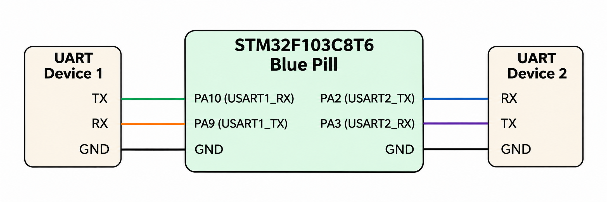

# CAT 10 – UART Communication

**EXP CAT:** CAT 10  
**TASK:** TASK 10A  
**NAME:** UART-to-UART Communication

## Objective
To configure two UART peripherals on the STM32F103C8T6 and show data being passed between them.

## Hardware and Software Requirements
- STM32F103C8T6 Blue Pill
- Two UART-capable serial devices
- STM32CubeMX
- Keil uVision

## Pin Connections

**USART1**

| UART Device 1 | STM32 Pin |
|---|---|
| TX | PA10 (USART1_RX) |
| RX | PA9 (USART1_TX) |
| GND | GND |

**USART2**

| STM32 Pin | UART Device 2 |
|---|---|
| PA2 (USART2_TX) | RX |
| PA3 (USART2_RX) | TX |
| GND | GND |

## Circuit Diagram

## UART Configuration

| Parameter | USART1 | USART2 |
|---|---|---|
| Baud Rate | 115200 | 115200 |
| Word Length | 8 Bits | 8 Bits |
| Stop Bits | 1 | 1 |
| Parity | None | None |
| Mode | Transmitter and Receiver | Transmitter and Receiver |
| Hardware Flow Control | None | None |

## Working Principle
- USART1 and USART2 are both initialised at 115200 baud.
- The program first sends the string `AT`, followed by a carriage return and newline, through USART1.
- The STM32 then waits to receive one byte on USART1.
- Every byte received is forwarded out through USART2.
- This continues indefinitely.

## Algorithm
1. Initialise the HAL library.
2. Configure the system clock.
3. Initialise GPIO.
4. Initialise USART1 and USART2.
5. Send the initial `AT` command through USART1.
6. Wait for one byte on USART1.
7. Send the received byte out through USART2.
8. Repeat.

## HAL Functions Used
- `HAL_Init()`
- `HAL_UART_Init()`
- `HAL_UART_Receive()`
- `HAL_UART_Transmit()`
- `HAL_RCC_OscConfig()`
- `HAL_RCC_ClockConfig()`

## Source Code
`Core/Src/main.c`

## Result
The STM32 reads data on USART1 and relays each received byte through USART2.

## Inference
This experiment demonstrates configuring and using several UART peripherals for serial data communication on the STM32 microcontroller.
