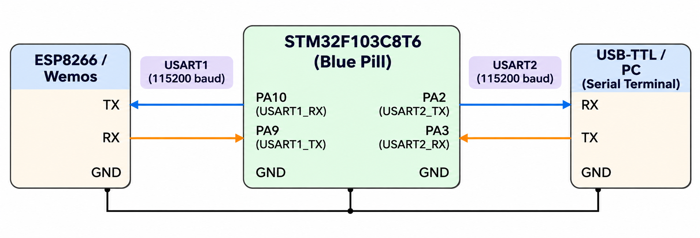

# CAT 10 – ESP8266 AT Command Interface

**EXP CAT:** CAT 10  
**TASK:** TASK 10B  
**NAME:** ESP8266 AT Command Interface

## Objective
To explore the ESP8266 AT command interface by sending commands from the STM32 and observing what the module replies.

## Hardware and Software Requirements
- STM32F103C8T6 Blue Pill
- ESP8266 / Wemos module
- USB-TTL converter
- STM32CubeMX
- Keil uVision
- Serial terminal software

## Pin Connections

**USART1 – STM32 to ESP8266**

| STM32 Pin | ESP8266 / Wemos |
|---|---|
| PA9 (USART1_TX) | RX |
| PA10 (USART1_RX) | TX |
| GND | GND |

**USART2 – STM32 to PC**

| STM32 Pin | USB-TTL Converter |
|---|---|
| PA2 (USART2_TX) | RX |
| PA3 (USART2_RX) | TX |
| GND | GND |

## Circuit Diagram

## UART Configuration

| Parameter | USART1 | USART2 |
|---|---|---|
| Baud Rate | 115200 | 115200 |
| Word Length | 8 Bits | 8 Bits |
| Stop Bits | 1 | 1 |
| Parity | None | None |
| Mode | Transmitter and Receiver | Transmitter and Receiver |

## Working Principle
- USART1 links the STM32 with the ESP8266.
- USART2 links the STM32 with the PC.
- The STM32 receives commands from the PC on USART2.
- Those characters are passed on to the ESP8266 through USART1.
- Replies from the ESP8266 arrive on USART1 and are forwarded to the PC via USART2.
- This lets the user try out ESP8266 AT commands from a serial terminal.

## AT Commands to Investigate

| Requirement | AT Command |
|---|---|
| Check modem response | `AT` |
| Check firmware/version | `AT+GMR` |
| Set Wi-Fi station mode | `AT+CWMODE=1` |
| Scan available networks | `AT+CWLAP` |
| Connect to an access point | `AT+CWJAP` |
| Obtain network information | `AT+CIFSR` |
| Establish TCP connection | `AT+CIPSTART` |
| Send application data | `AT+CIPSEND` |

## Algorithm
1. Initialise the HAL library.
2. Configure the system clock.
3. Initialise GPIO.
4. Initialise USART1 and USART2.
5. Show the AT command interface on the PC serial terminal.
6. Receive characters from the PC on USART2.
7. Forward them to the ESP8266 through USART1.
8. Receive the ESP8266's responses on USART1.
9. Forward those responses to the PC through USART2.
10. Repeat.

## HAL Functions Used
- `HAL_Init()`
- `HAL_UART_Init()`
- `HAL_UART_Receive()`
- `HAL_UART_Transmit()`
- `HAL_RCC_OscConfig()`
- `HAL_RCC_ClockConfig()`

## Source Code
`Core/Src/main.c`

## Result
The STM32 works as a UART bridge between the PC and the ESP8266, so AT commands can be sent and the module's replies observed.

## Inference
This experiment demonstrates serial communication across two UART peripherals and an exploration of the ESP8266 AT command interface.
