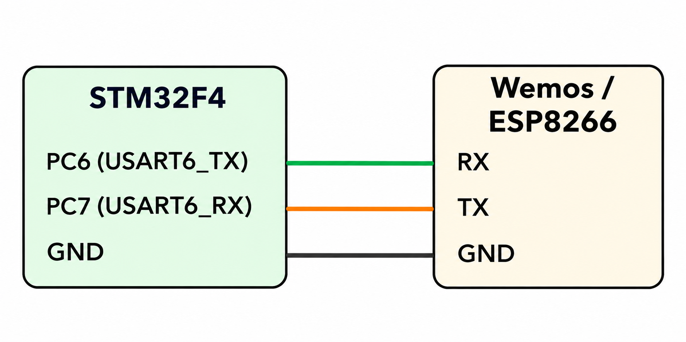

# CAT 11 – STM32-Based HTTP Web Server Using ESP8266

**EXP CAT:** CAT 11  
**TASK:** TASK 11B  
**NAME:** HTTP Web Server Using ESP8266

## Objective
To build a simple web server with an STM32 and an ESP8266 Wi-Fi module. The server answers HTTP requests with an HTML page showing a randomly generated letter.

## Hardware and Software Requirements
- STM32F4 microcontroller board
- ESP8266 / Wemos module
- STM32CubeMX
- Keil uVision
- Wi-Fi access point
- Web browser

## Pin Connections

| STM32F4 Pin | Wemos / ESP8266 |
|---|---|
| PC6 (USART6_TX) | RX |
| PC7 (USART6_RX) | TX |
| GND | GND |

## Circuit Diagram

## UART Configuration

| Parameter | Configuration |
|---|---|
| UART Peripheral | USART6 |
| Baud Rate | 115200 |
| Word Length | 8 Bits |
| Stop Bits | 1 |
| Parity | None |
| Mode | Transmitter and Receiver |

## Working Principle
- The STM32 sets up USART6 to talk to the ESP8266.
- It checks communication with the `AT` command.
- It puts the ESP8266 into Wi-Fi station mode.
- It joins the specified Wi-Fi network.
- It retrieves the network information and starts a TCP server on port 80.
- When a browser sends an HTTP request, the ESP8266 passes it to the STM32.
- The STM32 pulls the connection ID out of the received data.
- It generates a random letter and builds an HTML response.
- The response is sent to the ESP8266 and on to the browser.
- The TCP connection is then closed.

## AT Commands Used

| Purpose | AT Command |
|---|---|
| Test communication | `AT` |
| Set Wi-Fi station mode | `AT+CWMODE=1` |
| Connect to Wi-Fi | `AT+CWJAP` |
| Get IP address | `AT+CIFSR` |
| Enable multiple connections | `AT+CIPMUX=1` |
| Start TCP server | `AT+CIPSERVER=1,80` |
| Send data | `AT+CIPSEND` |
| Close connection | `AT+CIPCLOSE` |

## Algorithm
1. Initialise the HAL library.
2. Configure the system clock.
3. Initialise GPIO and USART6.
4. Wait for the ESP8266 to start up.
5. Send AT commands to join Wi-Fi.
6. Enable multiple connections.
7. Start the TCP server on port 80.
8. Wait for an incoming HTTP request.
9. Extract the connection ID from the request.
10. Generate a random letter.
11. Build an HTML page containing that letter.
12. Send the HTTP response to the browser.
13. Close the TCP connection.
14. Repeat.

## HAL Functions Used
- `HAL_Init()`
- `HAL_Delay()`
- `HAL_UART_Init()`
- `HAL_UART_Transmit()`
- `HAL_UART_Receive()`
- `HAL_GetTick()`
- `HAL_RCC_OscConfig()`
- `HAL_RCC_ClockConfig()`

## Source Code
`Core/Src/main.c`

## Result
A basic HTTP web server runs on the STM32 and ESP8266. When a client opens the server in a browser, it gets back a page showing a greeting and a randomly generated letter.

## Inference
This experiment demonstrates Wi-Fi communication, TCP server setup, HTTP request handling and dynamic web page generation on an STM32 microcontroller.
