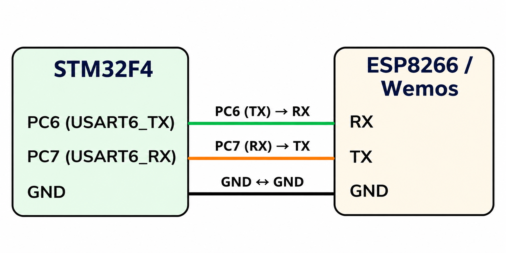

# CAT 11 – HTTP Web Server with Dynamic Webpage

**EXP CAT:** CAT 11  
**TASK:** TASK 11C  
**NAME:** HTTP Web Server with Random Letter Generation

## Objective
To build an HTTP web server with an STM32F4 and an ESP8266 Wi-Fi module. The server receives browser requests and replies with an HTML page showing a greeting and a randomly generated letter.

## Hardware and Software Requirements
- STM32F4 microcontroller board
- ESP8266 / Wemos module
- STM32CubeMX
- Keil uVision
- Wi-Fi access point
- Web browser

## Pin Connections

| STM32F4 Pin | ESP8266 / Wemos |
|---|---|
| PC6 (USART6_TX) | RX |
| PC7 (USART6_RX) | TX |
| GND | GND |

## Circuit Diagram

## UART Configuration

| Parameter | Configuration |
|---|---|
| UART Peripheral | USART6 |
| Baud Rate | 115200 |
| Word Length | 8 Bits |
| Stop Bits | 1 |
| Parity | None |
| Mode | Transmitter and Receiver |

## Working Principle
- The STM32 sets up USART6 to communicate with the ESP8266.
- It verifies communication using the `AT` command.
- It puts the ESP8266 into Wi-Fi station mode.
- It joins the specified Wi-Fi network.
- It obtains the IP address and starts a TCP server on port 80.
- The STM32 then keeps waiting for incoming HTTP requests.
- It extracts the connection ID from the received `+IPD` message.
- It picks a random letter from A to Z.
- It builds an HTML page containing a greeting and that letter.
- It sends the HTTP response to the browser through the ESP8266.
- After the response is sent, the TCP connection is closed.

## AT Commands Used

| Purpose | AT Command |
|---|---|
| Test communication | `AT` |
| Set Wi-Fi station mode | `AT+CWMODE=1` |
| Connect to Wi-Fi | `AT+CWJAP` |
| Get IP address | `AT+CIFSR` |
| Start TCP server | `AT+CIPSERVER=1,80` |
| Send data | `AT+CIPSEND` |
| Close connection | `AT+CIPCLOSE` |

## Algorithm
1. Initialise the HAL library.
2. Configure the system clock.
3. Initialise GPIO and USART6.
4. Wait for the ESP8266 to start up.
5. Test communication with the ESP8266.
6. Set Wi-Fi station mode.
7. Join the Wi-Fi access point.
8. Obtain the ESP8266 IP address.
9. Start the TCP server on port 80.
10. Wait for an incoming HTTP request.
11. Extract the TCP connection ID.
12. Generate a random letter.
13. Build an HTML response containing that letter.
14. Send the response to the browser.
15. Close the TCP connection and go back to waiting for requests.

## HAL Functions Used
- `HAL_Init()`
- `HAL_Delay()`
- `HAL_UART_Init()`
- `HAL_UART_Transmit()`
- `HAL_UART_Receive()`
- `HAL_GetTick()`
- `HAL_RCC_OscConfig()`
- `HAL_RCC_ClockConfig()`

## Source Code
`Core/Src/main.c`

## Result
An HTTP web server runs on the STM32F4 and ESP8266. A browser that visits the server receives an HTML page with a greeting and a randomly generated letter.

## Inference
This experiment demonstrates UART communication, ESP8266 Wi-Fi setup, TCP server operation, HTTP request handling and dynamic web page generation on an STM32 microcontroller.
