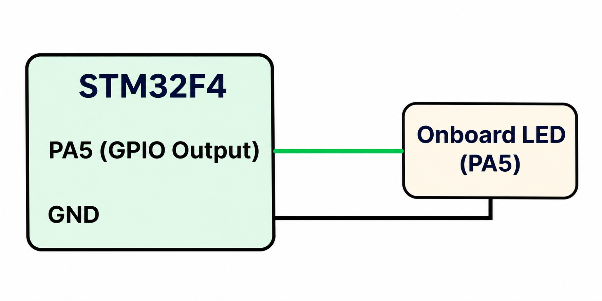

# CAT 12 – STM32 LED Pattern Generation

## EXP CAT12 TASK12A

### Name
LED Pattern Generation Using GPIO Output

### Board
STM32F4

### Software Used
- STM32CubeMX
- Keil uVision

### Circuit Diagram

### Description
This experiment controls an LED through GPIO output on the STM32F4 board. The LED on PA5 is switched with GPIO write operations to produce a repeating blink pattern.

### Pin Configuration

| Component | STM32 Pin |
|---|---|
| LED | PA5 |

### Working
The program produces this repeating LED pattern:

1. LED ON for 200 ms.
2. LED OFF for 200 ms.
3. LED ON for 200 ms.
4. LED OFF for 200 ms.
5. LED ON for 2000 ms.
6. LED OFF for 100 ms.
7. The sequence then starts over, indefinitely.

### HAL Functions Used
- `HAL_GPIO_WritePin()` – Drives the LED output HIGH or LOW.
- `HAL_Delay()` – Supplies the required delays.

### Source Code
`Core/Src/main.c`

### Inference
The experiment shows GPIO output control and the generation of a fixed LED blink pattern using HAL functions and software delays.
