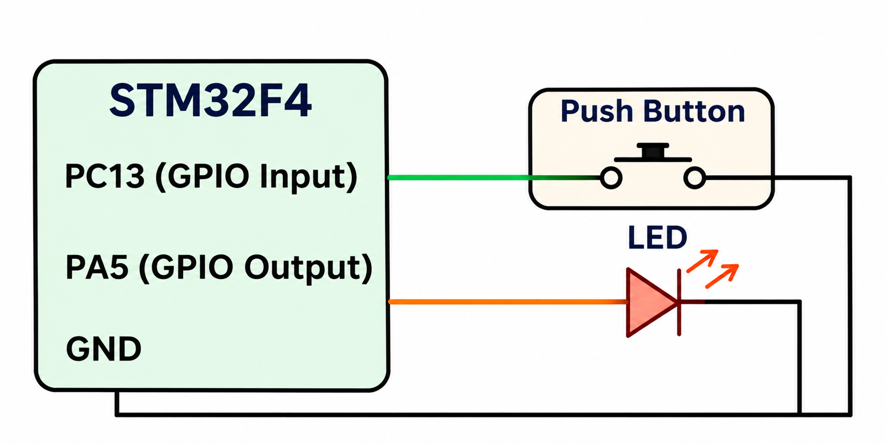

# CAT 12 – GPIO Button-Controlled LED

**EXP:** CAT 12 – TASK 12B

## Experiment Name
Button-Controlled LED Toggle

## Board
STM32 Development Board

## Components Used
- STM32 Development Board
- Push Button
- External LED
- Connecting wires

## Pin Connections

| Component | STM32 Pin |
|---|---|
| Push Button | PC13 |
| External LED | PA5 |
| LED GND connection | GND |

## Description
This experiment uses a push button to control an external LED. The STM32 reads the button on PC13, and each valid press changes the state of the LED on PA5.

A 20 ms debounce delay keeps switch bounce from causing multiple toggles.

## Working
1. Configure PC13 as a GPIO input.
2. Configure PA5 as a GPIO output.
3. Keep reading the button state.
4. On detecting a press, apply a 20 ms debounce delay.
5. Toggle the LED.
6. Wait for the button to be released before looking for the next press.

## Circuit Diagram

## HAL Functions Used
- `HAL_GPIO_ReadPin()`
- `HAL_GPIO_WritePin()`
- `HAL_Delay()`

## Source File
`Core/Src/main.c`

## Inference
The external LED switches between ON and OFF each time the button is pressed.
