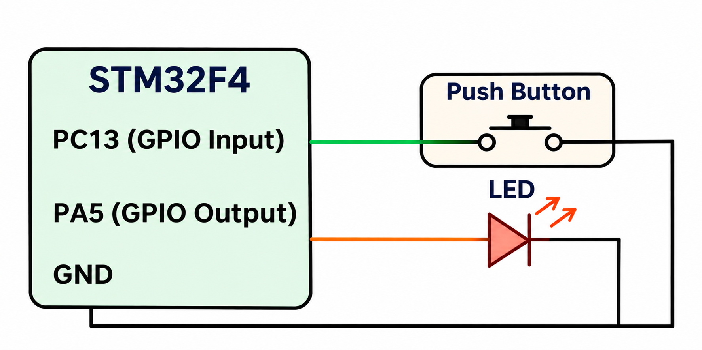

# CAT 12 – GPIO Button-Controlled LED

**EXP:** CAT 12 – TASK 12C

## Experiment Name
Short Press and Long Press LED Control

## Board
STM32 Development Board

## Components Used
- STM32 Development Board
- Push Button
- External LED
- Connecting wires

## Pin Connections

| Component | STM32 Pin |
|---|---|
| Push Button | PC13 |
| External LED | PA5 |
| LED GND connection | GND |

## Description
This experiment drives an external LED using short and long button presses. The STM32 reads the button on PC13 and controls the LED on PA5.

## Working
1. Configure PC13 as a GPIO input.
2. Configure PA5 as a GPIO output.
3. Keep monitoring the button state.
4. Apply a 20 ms delay to debounce the button.
5. Measure how long the button is held.
6. If the press lasts under 1 second, toggle the LED.
7. If it lasts 1 second or more, start continuous LED blinking with a 500 ms delay.

## Circuit Diagram

## HAL Functions Used
- `HAL_GPIO_ReadPin()`
- `HAL_GPIO_WritePin()`
- `HAL_GPIO_TogglePin()`
- `HAL_GetTick()`
- `HAL_Delay()`

## Source File
`Core/Src/main.c`

## Inference
A short press toggles the external LED ON or OFF, while a long press starts continuous blinking. The blinking carries on until the board is reset.
