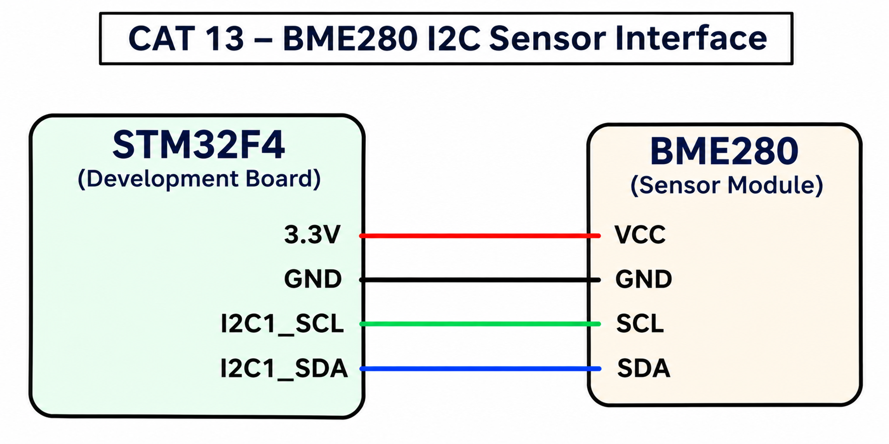

# CAT 13 – BME280 Sensor Interface

**Experiment:** CAT 13

## Experiment Name
Interfacing BME280 Sensor with STM32 using I2C

## Board
STM32F4 Development Board

## Components Used
- STM32F4 Development Board
- BME280 Sensor Module
- Connecting wires

## Communication Protocol
I2C

## Pin Connections

| STM32 | BME280 |
|---|---|
| 3.3V | VCC |
| GND | GND |
| I2C1_SCL | SCL |
| I2C1_SDA | SDA |

## Description
This experiment connects a BME280 sensor to the STM32 over I2C. The sensor measures temperature, atmospheric pressure and humidity.

## Working
1. Initialise the STM32 peripherals, including I2C1.
2. Set the BME280's I2C address in the sensor configuration.
3. Initialise the sensor with the BME280 driver.
4. Set temperature, pressure and humidity oversampling to 1x.
5. Put the sensor into normal operating mode.
6. Read the temperature, pressure and humidity values from the sensor.
7. Repeat the readings once every second.

## Sensor Configuration
- Temperature oversampling: 1x
- Pressure oversampling: 1x
- Humidity oversampling: 1x
- Filter: Disabled
- Operating mode: Normal

## Circuit Diagram

## HAL and BME280 Functions Used
- `HAL_I2C_Mem_Read()`
- `HAL_I2C_Mem_Write()`
- `HAL_Delay()`
- `bme280_init()`
- `bme280_set_sensor_settings()`
- `bme280_set_sensor_mode()`
- `bme280_get_sensor_data()`

## Source Files
- `Core/Src/main.c`
- `bme280.c`
- `bme280.h`

## Inference
The BME280 sensor communicates with the STM32 over I2C. The program keeps reading temperature, pressure and humidity at one-second intervals.
