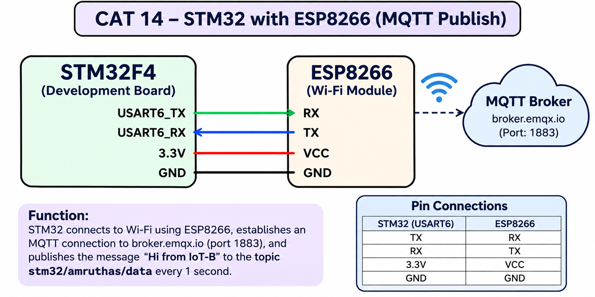

# CAT 14 – STM32 with ESP8266 using MQTT

## Experiment Details

- **Experiment:** CAT 14
- **Name:** MQTT Message Publishing using STM32 and ESP8266
- **Microcontroller:** STM32F4
- **Wi-Fi Module:** ESP8266
- **Communication:** UART
- **MQTT Broker:** broker.emqx.io
- **Port:** 1883

## Objective

To join a Wi-Fi network from an STM32 through an ESP8266 module, open an MQTT connection to a broker and publish messages to a topic at regular intervals.

## Circuit Diagram

## Connections

| STM32 | ESP8266 |
|---|---|
| USART6 TX | RX |
| USART6 RX | TX |
| 3.3V | VCC |
| GND | GND |

## Working

1. Initialise the STM32 peripherals and USART6 communication.
2. Initialise the ESP8266 in Station Mode.
3. Connect the ESP8266 to the Wi-Fi network.
4. Open a TCP connection to the MQTT broker.
5. Configure the MQTT client and connect to the broker.
6. Publish the message `Hi from IoT-B` to the topic `stm32/shakthi/data`.
7. Repeat the publish every second.

## MQTT Configuration

| Parameter | Value |
|---|---|
| Broker | broker.emqx.io |
| Port | 1883 |
| Client ID | STM32_Publisher |
| Topic | stm32/shakthi/data |
| Message | Hi from IoT-B |
| QoS | 0 |

## Functions Used

- `ESP8266_Init()` – Initialises the ESP8266 module.
- `ESP8266_wifiConnect()` – Joins the Wi-Fi network.
- `ESP8266_portConnect()` – Opens the TCP connection.
- `MQTT_connectBroker()` – Connects the MQTT client to the broker.
- `MQTT_publishTopic()` – Publishes data to the given MQTT topic.
- `HAL_Delay()` – Sets the one-second publishing interval.

## Inference

The STM32 uses the ESP8266 for Wi-Fi connectivity and MQTT communication, publishing the specified message to the broker once every second.
