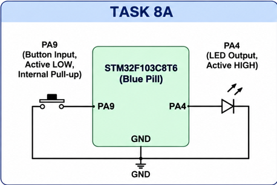

# CAT 8 – GPIO Input/Output

**EXP CAT:** CAT 8  
**TASK:** TASK 8A  
**NAME:** GPIO Input/Output

## Objective
To connect a push button and an LED to the STM32F103C8T6 and have the button state control the LED.

## Hardware and Software Requirements
- STM32F103C8T6 Blue Pill
- Push button
- LED
- STM32CubeMX
- Keil uVision

## Pin Connections

| Component | STM32 Pin | Configuration |
|---|---|---|
| Push Button | PA9 | Input, active LOW, internal pull-up |
| LED | PA4 | Output, active HIGH |

## Circuit Diagram

## Working Principle
- PA9 is set as a GPIO input with the internal pull-up enabled.
- With the button released, PA9 reads HIGH.
- Pressing the button pulls PA9 LOW.
- PA4 is set as a GPIO output.
- The LED lights while the button is held and goes off when it is released.

## Algorithm
1. Initialise the HAL library.
2. Configure the system clock.
3. Initialise the GPIO pins.
4. Read the button state on PA9.
5. If PA9 is LOW, drive PA4 HIGH.
6. Otherwise, drive PA4 LOW.
7. Repeat.

## HAL Functions Used
- `HAL_Init()`
- `HAL_GPIO_ReadPin()`
- `HAL_GPIO_WritePin()`
- `HAL_RCC_OscConfig()`
- `HAL_RCC_ClockConfig()`
- `HAL_GPIO_Init()`

## Source Code
`Core/Src/main.c`

## Result
The LED follows the push button: it is ON while the button is pressed and OFF when it is released.

## Inference
This experiment illustrates basic GPIO input and output on the STM32 microcontroller.
