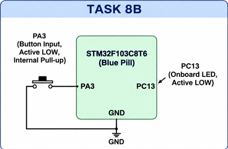

# CAT 8 – GPIO Input/Output

**EXP CAT:** CAT 8  
**TASK:** TASK 8B  
**NAME:** Event-Based LED Control

## Objective
To toggle the onboard LED with a push button, using event-based control with debouncing.

## Hardware and Software Requirements
- STM32F103C8T6 Blue Pill
- Push button
- STM32CubeMX
- Keil uVision

## Pin Connections

| Component | STM32 Pin | Configuration |
|---|---|---|
| Push Button | PA3 | Input, active LOW, internal pull-up |
| Onboard LED | PC13 | Output, active LOW |

## Circuit Diagram

## Working Principle
- PA3 is a GPIO input with the internal pull-up enabled.
- Pressing the button pulls PA3 LOW.
- A 20 ms delay debounces the button.
- The button is sampled once more to confirm the press is genuine.
- The onboard LED on PC13 changes state exactly once for each confirmed press.
- The program then waits for the button to be released before looking for the next press.

## Algorithm
1. Initialise the HAL library.
2. Configure the system clock.
3. Set PA3 up as an input with pull-up.
4. Set PC13 up as an output.
5. Keep reading the button state.
6. When the button is pressed, wait 20 ms.
7. Read the button again.
8. If the press is confirmed, toggle the LED.
9. Wait for the button to be released.
10. Repeat.

## HAL Functions Used
- `HAL_Init()`
- `HAL_GPIO_ReadPin()`
- `HAL_GPIO_WritePin()`
- `HAL_GPIO_TogglePin()`
- `HAL_Delay()`
- `HAL_RCC_OscConfig()`
- `HAL_RCC_ClockConfig()`
- `HAL_GPIO_Init()`

## Source Code
`Core/Src/main.c`

## Result
The onboard LED toggles once per confirmed button press, and debouncing stops contact bounce from causing extra toggles.

## Inference
This experiment shows event-based GPIO control and basic software debouncing on the STM32 microcontroller.
