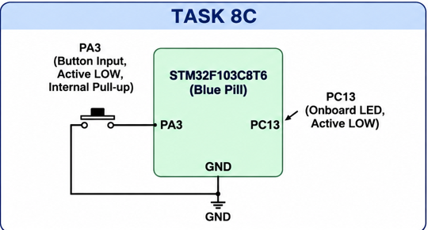

# CAT 8 – GPIO Input/Output

**EXP CAT:** CAT 8  
**TASK:** TASK 8C  
**NAME:** Short Press and Long Press Detection

## Objective
To tell short and long button presses apart and drive the onboard LED accordingly, with long presses detected without blocking.

## Hardware and Software Requirements
- STM32F103C8T6 Blue Pill
- Push button
- STM32CubeMX
- Keil uVision

## Pin Connections

| Component | STM32 Pin | Configuration |
|---|---|---|
| Push Button | PA3 | Input, active LOW, internal pull-up |
| Onboard LED | PC13 | Output, active LOW |

## Circuit Diagram

## Working Principle
- PA3 is a GPIO input with the internal pull-up enabled.
- PC13 is a GPIO output driving the onboard LED.
- A 20 ms debounce interval is used to recognise stable button states.
- A short press (under 1 second) toggles the LED.
- A long press (1 second or longer) starts blinking mode.
- In blinking mode, the LED toggles every 500 ms without any blocking delays.
- Blinking carries on after the button is released.
- A later short press ends the blinking and switches the LED OFF.

## Algorithm
1. Initialise the HAL library.
2. Configure the system clock.
3. Set PA3 up as an input with pull-up.
4. Set PC13 up as an output.
5. Keep reading the button state.
6. Apply a 20 ms debounce to identify stable states.
7. Note the time at which the button was pressed.
8. If the button stays down for 1 second or more, enable blinking mode.
9. If it is released in under 1 second, toggle the LED.
10. While in blinking mode, toggle the LED every 500 ms.
11. If a short press occurs during blinking, stop blinking and turn the LED OFF.
12. Repeat.

## HAL Functions Used
- `HAL_Init()`
- `HAL_GPIO_ReadPin()`
- `HAL_GPIO_WritePin()`
- `HAL_GPIO_TogglePin()`
- `HAL_GetTick()`
- `HAL_RCC_OscConfig()`
- `HAL_RCC_ClockConfig()`
- `HAL_GPIO_Init()`

## Source Code
`Core/Src/main.c`

## Result
A short press toggles the onboard LED, and a long press puts it into blinking mode. The blinking relies on non-blocking time checks.

## Inference
This experiment covers short/long press detection, software debouncing and non-blocking LED control on the STM32 microcontroller.
