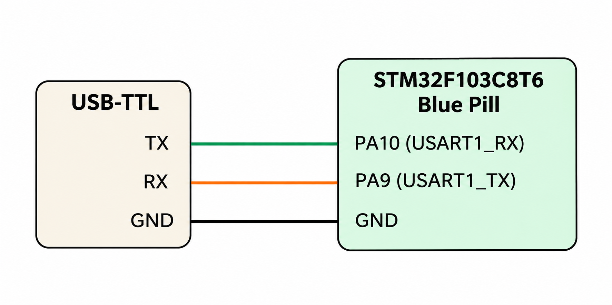

# CAT 9 – UART Communication

**EXP CAT:** CAT 9  
**TASK:** TASK 9A  
**NAME:** UART Communication – Data Reception and Transmission

## Objective
To set up UART communication between the STM32F103C8T6 and a USB-TTL converter, receive a character and send the same character back.

## Hardware and Software Requirements
- STM32F103C8T6 Blue Pill
- USB-TTL converter
- STM32CubeMX
- Keil uVision
- Serial terminal software

## Pin Connections

| USB-TTL | STM32F103C8T6 |
|---|---|
| TX | PA10 (USART1_RX) |
| RX | PA9 (USART1_TX) |
| GND | GND |

## Circuit Diagram

## UART Configuration

| Parameter | Configuration |
|---|---|
| UART Peripheral | USART1 |
| Baud Rate | 115200 |
| Word Length | 8 Bits |
| Stop Bits | 1 |
| Parity | None |
| Mode | Transmitter and Receiver |
| Hardware Flow Control | None |

## Working Principle
- USART1 is initialised at 115200 baud.
- The STM32 waits until it receives one byte over UART.
- Once a byte arrives, the program pauses for 1 second.
- It then sends the same byte back over UART.
- After another 1-second pause, the cycle starts again.

## Algorithm
1. Initialise the HAL library.
2. Configure the system clock.
3. Initialise GPIO and USART1.
4. Wait to receive one byte over UART.
5. Store the received byte.
6. Wait 1 second.
7. Transmit the stored byte back.
8. Wait another 1 second.
9. Repeat.

## HAL Functions Used
- `HAL_Init()`
- `HAL_UART_Receive()`
- `HAL_UART_Transmit()`
- `HAL_Delay()`
- `HAL_UART_Init()`
- `HAL_RCC_OscConfig()`
- `HAL_RCC_ClockConfig()`

## Source Code
`Core/Src/main.c`

## Result
The STM32 takes in a byte from the USB-TTL converter and returns the same byte after a delay.

## Inference
This experiment illustrates basic UART serial communication, covering both reception and transmission on USART1.
