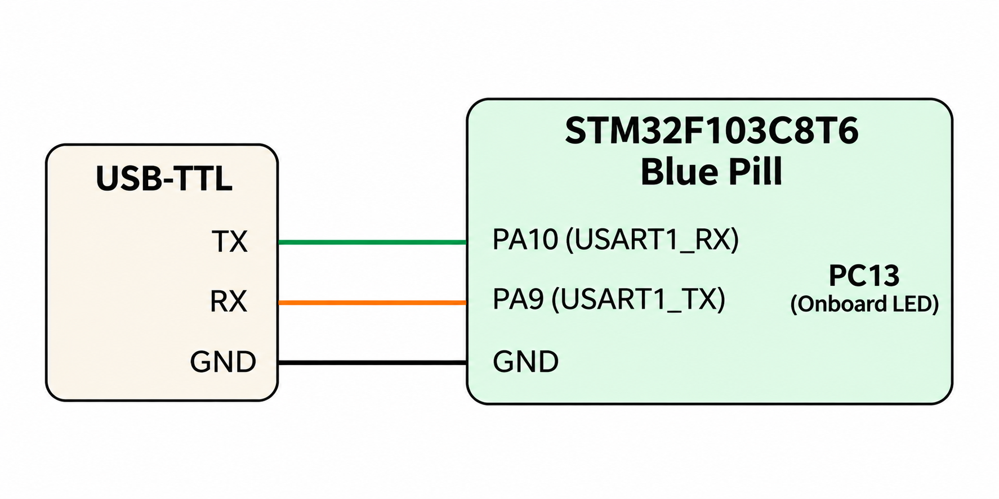

# CAT 9 – UART Communication

**EXP CAT:** CAT 9  
**TASK:** TASK 9B  
**NAME:** UART-Based LED Control Using Commands

## Objective
To control the STM32F103C8T6's onboard LED with commands received over UART.

## Hardware and Software Requirements
- STM32F103C8T6 Blue Pill
- USB-TTL converter
- STM32CubeMX
- Keil uVision
- Serial terminal software

## Pin Connections

| USB-TTL | STM32F103C8T6 |
|---|---|
| TX | PA10 (USART1_RX) |
| RX | PA9 (USART1_TX) |
| GND | GND |

| Onboard Component | STM32 Pin |
|---|---|
| LED | PC13 |

## Circuit Diagram

## UART Configuration

| Parameter | Configuration |
|---|---|
| UART Peripheral | USART1 |
| Baud Rate | 9600 |
| Word Length | 8 Bits |
| Stop Bits | 1 |
| Parity | None |
| Mode | Transmitter and Receiver |
| Hardware Flow Control | None |

## Working Principle
- USART1 is initialised for serial communication at 9600 baud.
- A command prompt is shown in the serial terminal.
- Commands typed by the user are received over UART.
- Depending on the command, the onboard LED on PC13 is controlled.
- The LED is driven through GPIO operations.
- The LED can also be set to toggle continuously every 500 ms.

## Supported Commands

| Command | Function |
|---|---|
| `LED ON` | Turns the onboard LED ON |
| `LED OFF` | Turns the onboard LED OFF |
| `LED TOGGLE` | Toggles the LED continuously every 500 ms |

Valid commands get a confirmation response, and invalid commands produce an error message.

## Algorithm
1. Initialise the HAL library.
2. Configure the system clock.
3. Initialise GPIO and USART1.
4. Start with the onboard LED OFF.
5. Show the UART command interface.
6. Receive characters from the serial terminal.
7. Buffer the characters until Enter is pressed.
8. Compare the received command with the supported ones.
9. Carry out the matching LED operation.
10. Print the response and the command prompt.
11. Repeat.

## HAL Functions Used
- `HAL_Init()`
- `HAL_UART_Init()`
- `HAL_UART_Receive()`
- `HAL_UART_Transmit()`
- `HAL_GPIO_WritePin()`
- `HAL_GPIO_TogglePin()`
- `HAL_GetTick()`
- `HAL_RCC_OscConfig()`
- `HAL_RCC_ClockConfig()`

## Source Code
`Core/Src/main.c`

## Result
UART commands control the onboard LED: sending the matching command turns it ON, turns it OFF, or makes it toggle continuously.

## Inference
This experiment shows UART-based command handling combined with GPIO control on the STM32 microcontroller.
